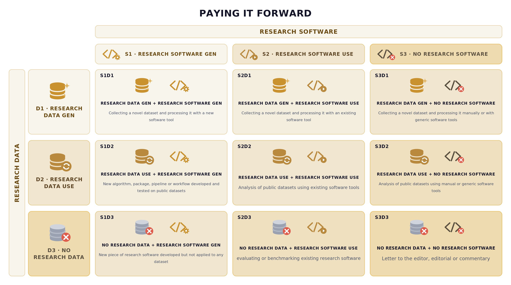

# paying-it-forward

**How are research outputs changing in the age of AI?**

This project aims to build a metric or set of criteria that describes whether a piece of research generates new research artefacts and what kind of artefacts are produced.

For this project, we have limited the scope to only software and data. Arguably, there are many types of research artefact such as a new theoretical methodology, hardware or protocols.



Each paper is classified into one of nine categories: software generated / used /
none (S1–S3) crossed with data generated / used / none (D1–D3). The definitions
are in [`factors/criteria/`](factors/criteria/).

## Experiments

An experiment is an attempt to classify a dataset of papers into one of the nine categories based on the current version of the criteria, prompt and reviewer.

### How experiments are organised

An **experiment** is one combination of five versioned factors, which are kept
together under `factors/`. A **run** is one pass of an experiment over its
dataset, and repeat runs are how consistency is measured.

| Factor | Lives in | Example ids |
|---|---|---|
| Dataset — which papers, and where their content is | `factors/datasets/<id>/` | `spike0-pmc30`, `trial2-openalex30` |
| Criteria — the definitions papers are classified against | `factors/criteria/<id>/criteria.md` | `v1`, `v2` |
| Prompt — the instructions given to a model | `factors/prompts/<id>/` (`system.md`, `task.md`) | `v1` |
| Input — what of each paper the reviewer reads | `factors/inputs/<id>.yaml` | `fulltext` (the default), `abstract-only` |
| Reviewer — a model with its settings, or a person | `factors/reviewers/<id>.yaml` | `gemma4-12b`, `sonnet5`, `human-matt` |

Results live under `experiments/`, one folder per experiment:

```
experiments/<dataset>/criteria-<id>__prompt-<id>__<input>__<reviewer>/
    experiment.json        factor ids and their fingerprints
    run-01/
        run.json           when, which commit, how far it got, failures, content fingerprints
        judgements.jsonl   one line per paper: category, reasoning, tokens/time or minutes
        source.xlsx        (human runs) the review sheet the run was imported from
    run-02/ ...
```

**Versions are fixed once used.** Every factor has a fingerprint over everything
in it that can change a result (descriptions and a dataset's build notes can still be edited). An
experiment pins the fingerprints it was created with, and running or importing
into it after one of its factors has changed is refused. To change the criteria,
copy `factors/criteria/v2/` to `factors/criteria/v3/` and edit that. `uv run pif check` verifies
every experiment against the registries.

Model settings belong to the reviewer, so `sonnet5` and a hypothetical
`sonnet5-effort-low` are two reviewers that can be compared like any other pair.

The code is one package, `pif/`, used by everything else:

| Module | Does |
|---|---|
| `registry.py` | loads and fingerprints the five factors |
| `store.py` | reads and writes experiments and runs; loads everything as DataFrames |
| `runner.py`, `providers.py`, `prompting.py` | run a model reviewer (Ollama or Anthropic) |
| `human.py` | export a review sheet for a person; import it back as a run |
| `metrics.py` | consensus, agreement, Cohen's and Fleiss' kappa — shared by the dashboard and the analysis |
| `content.py` | build a dataset's text from its PDFs |
| `cli.py` | the `pif` command |

`uv run pytest` tests the pipeline (resuming, the fixed-version check, review
sheets, the metrics) against a tiny throwaway registry.

### Setup

```
uv sync
```

Create `.secrets` in the repo root (gitignored) with what you need:

```
ANTHROPIC_API_KEY=sk-ant-...
OLLAMA_HOST=http://localhost:11434   # optional; this is the default
```

The model a reviewer uses is in its `factors/reviewers/*.yaml` file, not in `.secrets`.
For Ollama, pull the model (`ollama pull gemma4:12b`) and make sure the server is
running.

Paper content is not committed. Each `dataset.yaml` says how to rebuild it:

```
uv run python factors/datasets/spike0-pmc30/scripts/build_content.py   # after spikes/spike0/fetch_corpus.py and download_pdfs.py
uv run pif dataset extract-text trial2-openalex30               # text from the downloaded PDFs
```

### Running models

```
uv run pif run --dataset trial2-openalex30 --criteria v2 --prompt v1 --reviewer gemma4-12b sonnet5 --repeats 5
```

- `--input` defaults to `fulltext`; pass `--input abstract-only` (or both) to change it.
- Any factor given several ids makes a grid: the command above is two experiments,
  one per reviewer.
- `--dry-run` lists each experiment, how many runs it has, and what would be started.
- `--repeats N` makes sure each experiment has N runs. Unfinished runs (interrupted,
  or papers whose request failed) are resumed first, judging only the missing
  papers. Rerunning a command after a crash, or raising `--repeats`, does only the
  outstanding work.
- `--limit N` is a trial run on the first N papers. It goes to `experiments/_scratch/`
  (gitignored), so it never mixes with real results.
- Every request is one paper with no shared context, and each judgement is written
  as soon as it arrives.

Reviewer settings: Ollama accepts `num_ctx`, `timeout_s`, `temperature`, `seed`,
`top_p` and `top_k`. Anthropic accepts `max_tokens`, `timeout_s`, `effort`,
`thinking` and `tool_choice`. The Messages API has rejected temperature and the
other sampling parameters since 2026-10-21, and newer Claude models need
`tool_choice: auto`.

### Human reviewers

```
uv run pif human export --dataset trial2-openalex30 --criteria v2 --prompt v1 --reviewer human-matt
# ... the reviewer fills in category, reasoning and minutes for each paper ...
uv run pif human import review-trial2-openalex30-criteria-v2-human-matt.xlsx
```

- The sheet has a category drop-down, the task and criteria text, and a hidden sheet
  that records which experiment it belongs to.
- On import, the sheet is checked and stored as the next run, with the sheet kept
  beside the judgements.
- A second sheet for the same experiment is a repeat pass, `run-02`.
- `--dry-run` checks a sheet without writing anything. `--allow-incomplete` accepts
  papers left blank.
- A sheet made some other way can be imported by naming the experiment with the five
  factor flags.

To add a reviewer, create `factors/reviewers/human-<name>.yaml` with `kind: human` and `name:`.

### Adding a version of something

- **Criteria or prompt:** add `factors/criteria/<new id>/criteria.md` or `factors/prompts/<new id>/`.
  `system.md` uses `{task}` and `{criteria}` placeholders.
- **Dataset:** add `factors/datasets/<id>/` containing:
  - `dataset.yaml`: title, description, provenance and content sources
  - `papers.csv`: committed; `paper_id` is the first column
  - `scripts/`: how it was drawn
  - `source/`: the raw draw files
  - `content/`: gitignored

  Content sources are JSONL text (`{paper_id, abstract, text}`) or per-paper PDFs.
  A different text extraction method is a new content source, read by its own input.
- **Input:** add `factors/inputs/<id>.yaml` with `body` (a content source name or `none`)
  and a `template` for the message. The placeholders are `papers.csv` columns plus
  `{abstract}` and `{text}`.
- **Reviewer:** add `factors/reviewers/<id>.yaml`.

## Results dashboard

```
uv run pif dashboard
```

A Streamlit app that reads `experiments/` directly, so there is nothing to rebuild:
refresh after a run. See [`dashboard/README.md`](dashboard/README.md).

